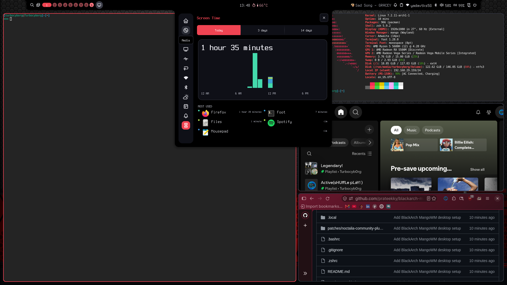
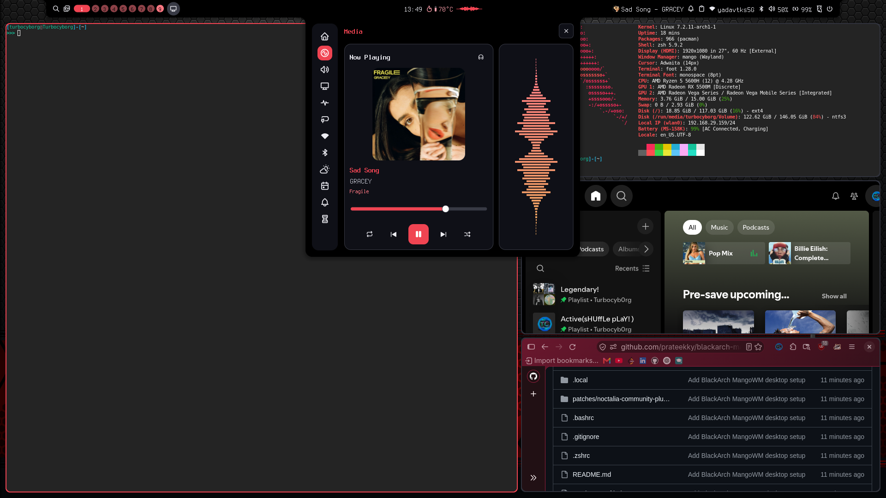
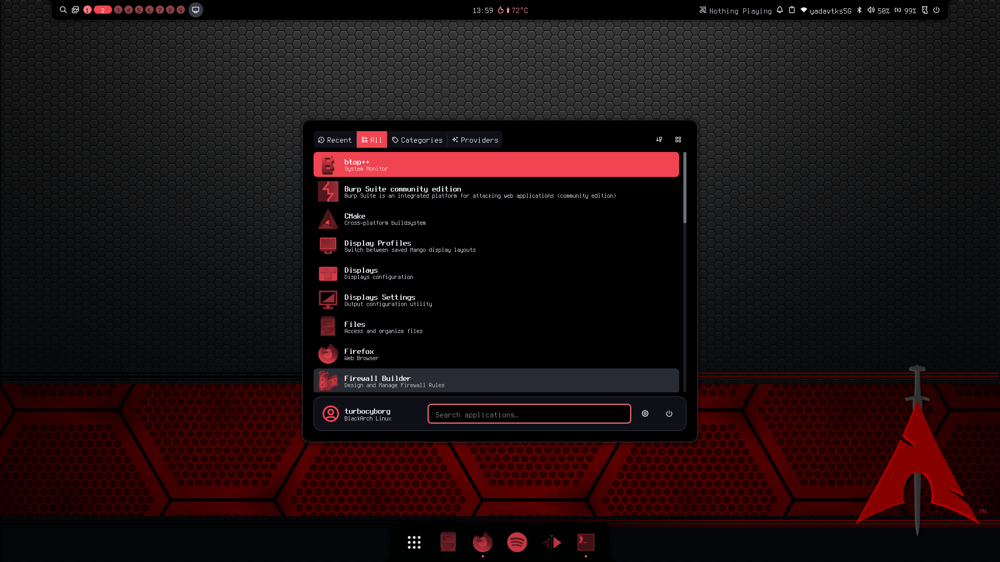
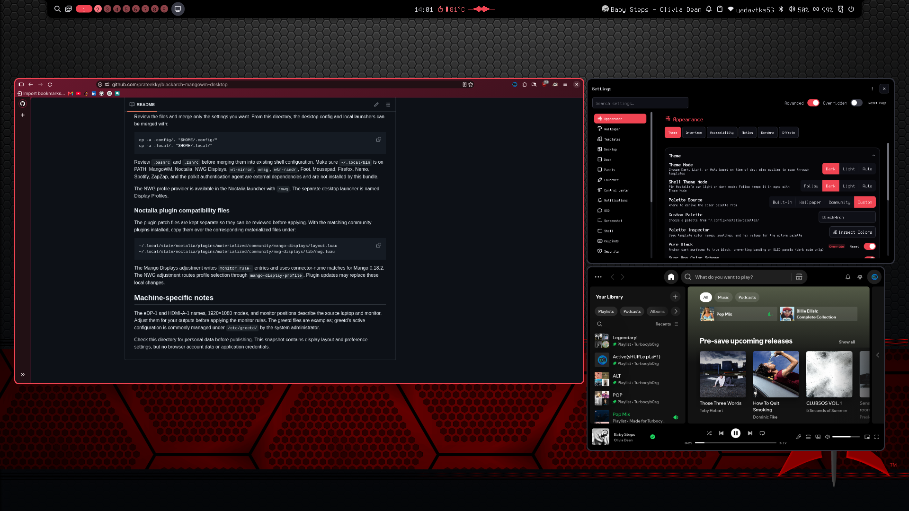

# BlackArch + MangoWM desktop setup

A shareable snapshot of the current MangoWM and Noctalia desktop configuration. The tree mirrors paths under a home directory and includes shell/editor defaults, display profiles, and relevant launchers. It excludes browser profiles, cookies, saved logins, Spotify app state, Wi-Fi credentials, and other application data. The screenshot gallery contains original, unredacted captures and visibly includes system, network, and account details.

## Screenshots

These screenshots show the desktop, Noctalia media controls, launcher, and appearance settings. They are the original, unredacted captures.

View desktop screenshots

## Contents

- `.config/mango/` — MangoWM bindings, gestures, mouse controls, animation settings, and current monitor rules.
- `.config/noctalia/` — Noctalia shell appearance and the BlackArch color palette.
- `.config/nwg-displays/` — internal-only, external-only, and both-display profiles. Monitor labels are generic; connector names and resolutions are specific to the source hardware. The external-only profile currently uses 60 Hz.
- `.config/mimeapps.list` — Firefox for web links, Nemo for directories, and Mousepad for plain text, Markdown, Python, and shell files.
- `.config/Mousepad/` — Mousepad keyboard shortcut preferences.
- `.bashrc` and `.zshrc` — shell defaults and aliases, including Mousepad as `EDITOR`, `VISUAL`, and the `vi` alias. The Zsh local-bin path uses `$HOME` for portability.
- `.local/bin/mango-display-profile` — applies saved NWG display profiles through Mango IPC and monitor rules.
- `.local/share/applications/` — display-profile and Spotify launchers.
- `patches/noctalia-community-plugins/` — local compatibility adjustments for Mango 0.18.2 and the NWG profile launcher. These are patches to community plugins, not bundled plugin packages.
- `monitors.conf.bak-20261025-202426` — the retained pre-change monitor-rule backup.

The current shell uses Noctalia for its bar, dock, and launcher. No active Waybar configuration was present in the home config directory, so unused Waybar helpers are not included.

## Install

Review the files and merge only the settings you want. From this directory, the desktop config and local launchers can be merged with:

    cp -a .config/. "$HOME/.config/"
    cp -a .local/. "$HOME/.local/"

Review `.bashrc` and `.zshrc` before merging them into existing shell configuration. Make sure `~/.local/bin` is on PATH. MangoWM, Noctalia, NWG Displays, `wl-mirror`, `mmsg`, `wlr-randr`, Foot, Mousepad, Firefox, Nemo, Spotify, ZapZap, and the polkit authentication agent are external dependencies and are not installed by this bundle.

The NWG profile provider is available in the Noctalia launcher with `/nwg`. The separate desktop launcher is named Display Profiles.

### Noctalia plugin compatibility files

The plugin patch files are kept separate so they can be reviewed before applying. With the matching community plugins installed, copy them over the corresponding materialized files under:

    ~/.local/state/noctalia/plugins/materialized/community/mango-displays/layout.luau
    ~/.local/state/noctalia/plugins/materialized/community/nwg-displays/lib/nwg.luau

The Mango Displays adjustment writes `monitor_rule=` entries and uses connector-name matches for Mango 0.18.2. The NWG adjustment routes profile selection through `mango-display-profile`. Plugin updates may replace these local changes.

## Machine-specific notes

The eDP-1 and HDMI-A-1 names, 1920×1080 modes, and monitor positions describe the source laptop and monitor. Adjust them for your outputs before applying the monitor rules. The greetd files are examples; greetd's active configuration is commonly managed under `/etc/greetd/` by the system administrator.

Check this directory for personal data before publishing. This snapshot contains display layout and preference settings, but no browser account data or application credentials.
